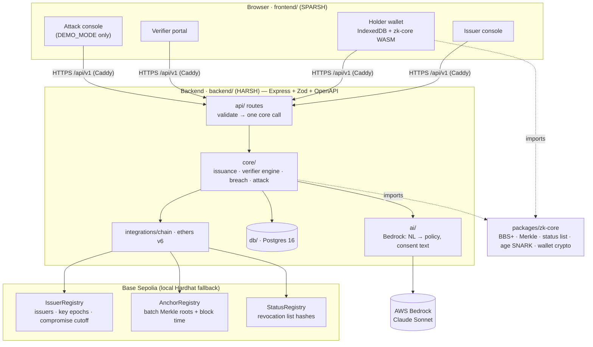
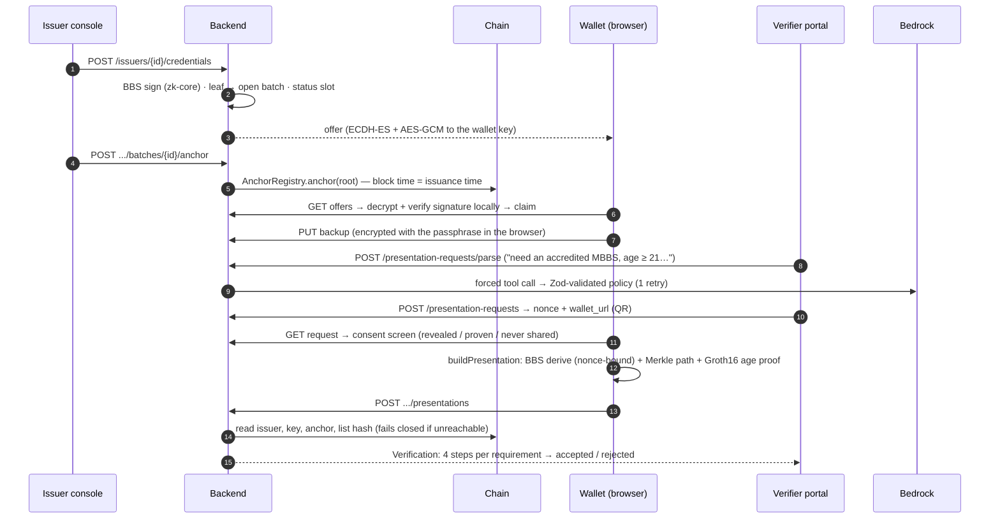
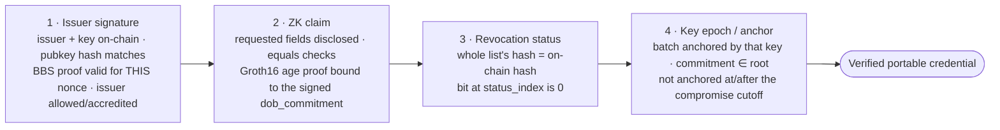
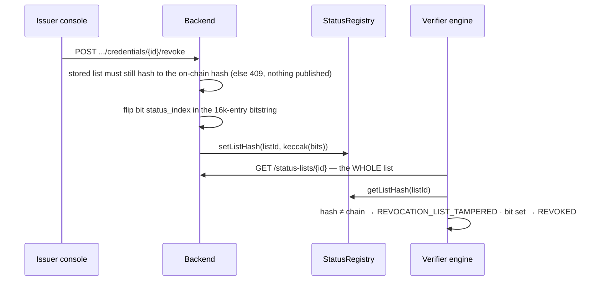
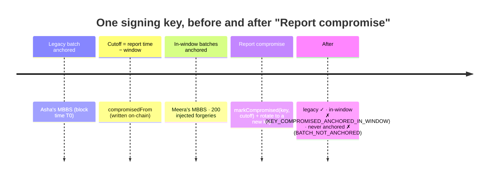
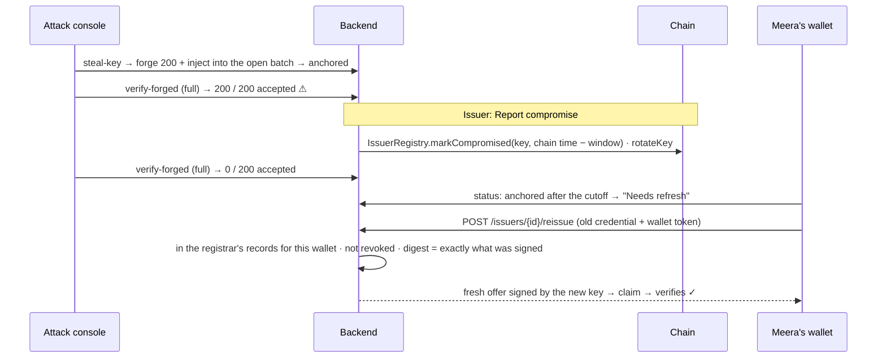
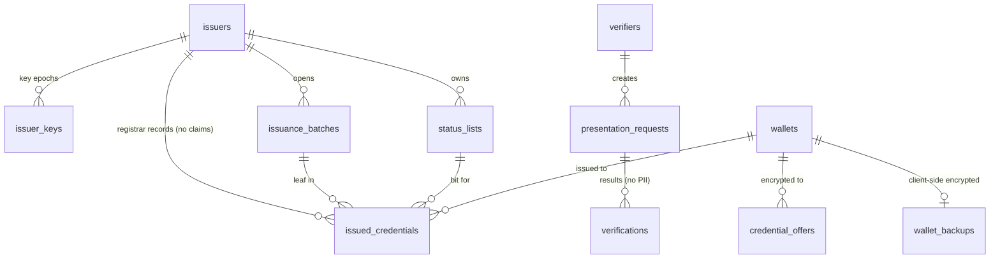
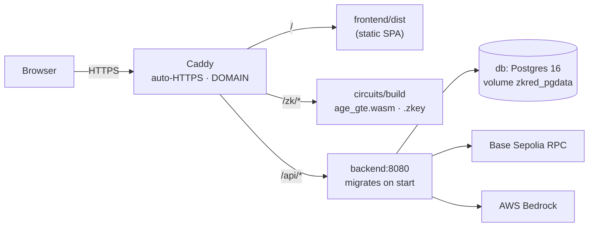

# ZKred architecture

How the pieces fit, drawn from [md/FLOWS.md](../md/FLOWS.md) (flows) and [md/CONTRACTS.md](../md/CONTRACTS.md) (API, DB, Solidity, env). Diagrams are Mermaid, so GitHub renders them.

**Trust model in one line:** the issuer signs (BBS+), the chain timestamps (anchor), the holder discloses (ZK), and the verifier checks all three without calling the issuer.

---

## 1. System overview



- **Dependency direction** (AGENTS.md §8.3): `api → core → db | integrations | ai`, never backwards. Routes hold no SQL, no chain calls, no crypto.
- **All cryptography lives in `packages/zk-core`.** It runs in Node (issuer signing, verification) and in the browser (proofs), and both sides import the same code.
- **No plaintext holder data at rest.** Claims are signed, encrypted to the holder's wallet key and dropped. The server keeps only the commitment, the batch and the status slot, plus a client-side-encrypted backup.

## 2. Credential anatomy

Every credential is a BBS+ signature over a frozen message vector (CONTRACTS §4.1). Indices never change:

| idx | field | revealed? |
|---|---|---|
| 0–6 | `cred_type`, `issuer_did`, `key_id`, `batch_id`, `status_list_id`, `status_index`, `commitment` | always (they drive the checks) |
| 7–8 | `issued_at` (informational), `holder_binding` (reserved) | no |
| 9+ | type fields, e.g. Degree: `holder_name`🔒 `degree_name` `major` `institution` `graduation_year` `grade`🔒 | only what the policy asks for |

- `commitment` is a random serial. Its hash is the **Merkle leaf** of the issuance batch.
- `GovernmentId` carries `dob_commitment = Poseidon(dob_days, dob_salt)`, so age is proven against a signed value without revealing `dob`.

## 3. Issue → claim → present → verify (the demo flow)



## 4. The verifier's eval chain

Each requirement runs these four steps in order and stops at the first failure (backend/src/core/verifier.ts). A rejection is a `200` with `result: "rejected"` and the failing step's code.



```text
valid ⇔ BBS signature verifies under keyId
      ∧ issuer accredited ∧ key registered
      ∧ ( key not compromised ∨ batchAnchoredAt(batchId) < key.compromisedFrom )
      ∧ batch root contains the credential commitment
      ∧ status bit == 0
```

## 5. Revocation (herd privacy)



Verifiers always download the whole list, and only its hash is on-chain, so nobody learns *whose* credential was checked or revoked.

## 6. Breach: chain time, not claimed time

Threat model: the attacker steals the BBS signing key **and** can inject leaves into the issuer's open batch (a compromised issuance server), so forgeries get anchored like real ones. The attacker does **not** control the registrar's records (`issued_credentials`) or the governance wallet.





Why forgeries can't escape:

- **No backdating.** A forged commitment isn't in any legacy batch's on-chain root (`MERKLE_PROOF_INVALID`), and anchors carry block time.
- **Isolated by the cutoff.** Forgeries anchored inside the window fail `KEY_COMPROMISED_ANCHORED_IN_WINDOW`; ones never anchored fail `BATCH_NOT_ANCHORED`.
- **No laundering.** Re-issue requires the commitment in the registrar's own records **and** the exact credential the issuer signed (its recorded digest). A stolen-key copy of an honest holder's serial with upgraded claims has a different signature, so it is refused.

## 7. Data model (Postgres)



`attack_state`, `attack_forgeries` and `attack_runs` hold the red-team console's data (DEMO_MODE only). They are never mixed into `issued_credentials`.

## 8. Deployment



One EC2 instance runs `docker compose` (db, backend, frontend build, Caddy). `infra/setup-ec2.sh` installs Docker; `infra/deploy.sh` builds, starts and waits for `/api/v1/health`. Steps: [README → Deploy on AWS EC2](../README.md#deploy-on-aws-ec2).
