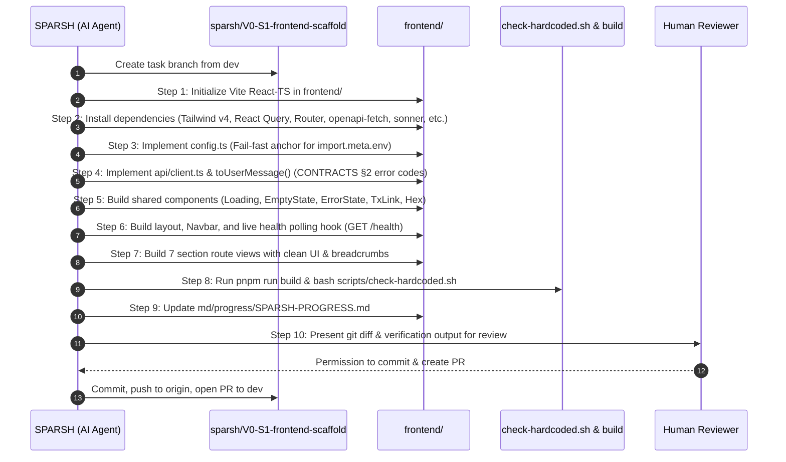

# Master Execution Plan: Task V0-S1 (Frontend Scaffold)

**Project:** ZKred — User-controlled, zero-knowledge portable credentials  
**Owner:** **SPARSH** (Frontend & DevOps Lead)  
**Task ID:** **`V0-S1`** ⭐ (Demo Critical Path)  
**Parent Milestone:** V0 — Foundation & Skeleton (Hours 0–2)  
**Target Branch:** `sparsh/V0-S1-frontend-scaffold` (branched from `dev`)  
**Status:** **PLANNING — AWAITING USER APPROVAL PRIOR TO EXECUTION**

---

## 1. Task Objective

Build and verify the complete frontend shell for ZKred. The resulting web application must run locally (`pnpm --filter frontend dev`), compile cleanly to production (`pnpm --filter frontend build`), pass all hardcoded-data checks, and render the core layout:
1. Top navigation with 4 dedicated sections (**Issuer Console**, **Holder Wallet**, **Verifier Portal**, **Red-Team Attack Console**).
2. Live status indicator dot polling `GET /health` every 15 seconds with tooltip health breakdown (DB, Chain, AI).
3. Seven route shells rendering structured layouts with loading, empty, and error state primitives.
4. Strict compliance with `CONTRACTS.md` (zero hardcoded URLs, zero literal mock data, fail-fast config).

---

## 2. Step-by-Step Task Sequence

---

## 3. Scope & File Deliverables

| File / Folder | Role & Description |
|---|---|
| `frontend/package.json` | Vite, React 19, Tailwind v4, TanStack Query, React Router, openapi-fetch, sonner, lucide-react. |
| `frontend/vite.config.ts` | Tailwind v4 plugin, standard `@/*` path resolution via `fileURLToPath`. |
| `frontend/tsconfig.app.json` | Modern bundler module resolution with `@/*` aliases. |
| `frontend/src/config.ts` | ⚓ The **ONLY** file allowed to read `import.meta.env`. Throws startup error if missing. |
| `frontend/.env.example` | Template declaring `VITE_API_BASE_URL` and `VITE_ZK_ARTIFACTS_BASE_URL`. |
| `frontend/src/api/client.ts` | `openapi-fetch` client + `toUserMessage()` translating all 15 error codes. |
| `frontend/src/api/types.ts` | Schema definitions mirroring `CONTRACTS.md` (enums, health, chain info). |
| `frontend/src/api/queries/meta.ts` | TanStack Query hooks: `useHealth` (15s poll), `useChainInfo`, `useEnums`, `useCredentialSchemas`. |
| `frontend/src/components/common/` | Reusable primitives: `<Loading/>`, `<EmptyState/>`, `<ErrorState/>`, `<TxLink/>`, `<Hex/>`. |
| `frontend/src/components/layout/` | `<Navbar/>` (4 section links + live health indicator dot) + `<Layout/>`. |
| `frontend/src/features/` | Route pages: `HomePage`, `IssuerListPage`, `IssuerDetailPage`, `WalletPage`, `WalletRespondPage`, `VerifierPage`, `RequestDetailPage`, `AttackConsolePage`. |
| `md/progress/SPARSH-PROGRESS.md` | Log entry and status board update for `V0-S1`. |

---

## 4. Verification & Done Criteria (Gate G0)

A task is **DONE** only when:
1. `pnpm --filter frontend build` completes with **0 errors**.
2. `bash scripts/check-hardcoded.sh` outputs **`check-hardcoded: OK`**.
3. All 7 routes render properly without runtime crashes.
4. Health indicator successfully queries `/health` every 15 seconds.
5. All changed files are 100% within `frontend/` and `md/progress/SPARSH-PROGRESS.md`.
6. User reviews and gives the command before any PR is created.
