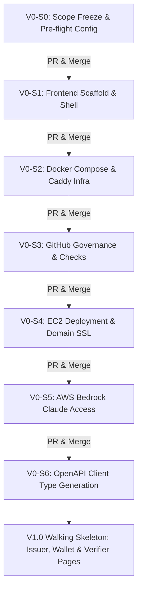

# ZKred — Master Execution Plan (SPARSH)

**Project:** ZKred — User-controlled, zero-knowledge portable credentials  
**Hackathon:** CASCADE '26 (IIIT Nagpur) · Theme 4 · Problem 3  
**Owner:** **SPARSH** (Frontend · DevOps / EC2 / Docker · Seed Pipeline · QA · Docs · Pitch)  
**Collaborator:** **HARSH** (Lead · Backend API + DB · Crypto Core / `zk-core` · Smart Contracts · Circuits · AI)  
**Status:** **AWAITING USER APPROVAL PRIOR TO TASK EXECUTION**

---

## 1. Operating Rules & PR Protocols

1. **Step-by-Step Sequence:**
   - Tasks are executed strictly in order: **`V0-S0` ➔ PR ➔ `V0-S1` ➔ PR ➔ `V0-S2` ➔ PR**.
   - No task begins until the previous task is presented, reviewed, approved, and submitted via PR.
2. **Branching Standard:**
   - Every task has its own short-lived feature branch branched from `dev`:
     - `sparsh/V0-S0-scope-setup`
     - `sparsh/V0-S1-frontend-scaffold`
     - `sparsh/V0-S2-infra-setup`
   - Never push directly to `main` or `dev`.
   - All PRs target `dev`.
3. **Folder Ownership (`AGENTS.md §1`):**
   - **SPARSH owns:** `frontend/`, `infra/`, `docker-compose.yml`, `scripts/`, `seed/`, `docs/`, `.github/`, `README.md`, all `*.env.example` files, `md/progress/SPARSH-PROGRESS.md`.
   - **Never touch:** `backend/`, `packages/zk-core/`, `contracts/`, `circuits/`, `md/CONTRACTS.md`, root `package.json`, root `pnpm-workspace.yaml`.
4. **Validation Before PR:**
   - Every branch must pass:
     - `bash scripts/check-hardcoded.sh` (zero hardcoded values)
     - `pnpm --filter <package> build` / `typecheck`
     - Updated log entry in `md/progress/SPARSH-PROGRESS.md`.

---

## 2. Detailed Task Roadmap

### Phase V0 — Foundation & Skeleton (Hours 0–2) · Gate G0

#### Task `V0-S0`: Project Kickoff, Scope Freeze & Environment Templates
- **Goal:** Formalize project scope freeze and establish all configuration templates.
- **Branch:** `sparsh/V0-S0-scope-setup`
- **Deliverables:**
  1. Freeze `md/MVP-SCOPE.md` status to `FROZEN at 18:30`.
  2. Create canonical `.env.example` templates matching `md/CONTRACTS.md §6`:
     - Root `.env.example` (ports, DB URL, chain RPC, Bedrock model).
     - `contracts/.env.example` (deployer private key, Base Sepolia RPC).
     - `scripts/.env.example` (seed target, admin token, passphrase).
  3. Validate repository health: run `bash scripts/check-hardcoded.sh`.
  4. Log progress in `md/progress/SPARSH-PROGRESS.md`.
- **Review Gate:** Present `git diff` to user ➔ wait for explicit command to open PR ➔ merge to `dev`.

#### Task `V0-S1` ⭐: Frontend Scaffold & Navigation Shell
- **Goal:** Initialize Vite React TypeScript frontend with Tailwind CSS v4, dark theme, top navigation, and live health indicator.
- **Branch:** `sparsh/V0-S1-frontend-scaffold`
- **Deliverables:**
  1. Scaffolding inside `frontend/` (Vite, React 19, TypeScript).
  2. Tailwind CSS v4 styling & dark theme tokens.
  3. Strict configuration singleton `frontend/src/config.ts` (the **only** file reading `import.meta.env`).
  4. Typed API client `frontend/src/api/client.ts` with error mapper `toUserMessage()`.
  5. Shared components: `<Loading/>`, `<EmptyState/>`, `<ErrorState/>`, `<TxLink/>`, `<Hex/>`.
  6. Section routes: `/issuer`, `/issuer/:issuerId`, `/wallet`, `/wallet/respond`, `/verifier`, `/verifier/requests/:requestId`, `/attack`.
  7. Top navigation bar with live health indicator dot polling `GET /health` every 15s.
- **Review Gate:** Run `pnpm run build` in `frontend/` + `scripts/check-hardcoded.sh` ➔ review with user ➔ open PR.

#### Task `V0-S2` ⭐: Container Infrastructure (Docker Compose & Caddy)
- **Goal:** Establish multi-container compose environment for Postgres 16, backend API, and Caddy reverse proxy with automatic SSL.
- **Branch:** `sparsh/V0-S2-infra-setup`
- **Deliverables:**
  1. Root `docker-compose.yml` defining `db`, `backend`, and `caddy` services.
  2. `infra/docker/backend.Dockerfile` (multi-stage Node 22 build).
  3. `infra/docker/frontend.Dockerfile` (builds static production bundle).
  4. `infra/caddy/Caddyfile` (reverse proxy `/api/v1/*` to backend:8080, serves SPA frontend and static `/zk` artifacts).
- **Review Gate:** Validate compose syntax and config ➔ review with user ➔ open PR.

#### Task `V0-S3`: GitHub Repository Governance & Checks
- **Goal:** Set up PR templates, CODEOWNERS, and verification scripts.
- **Branch:** `sparsh/V0-S3-repo-governance`

#### Task `V0-S4` ⭐: EC2 Deployment & Live Domain
- **Goal:** Deploy Docker Compose on Ubuntu EC2 instance with public HTTPS.
- **Branch:** `sparsh/V0-S4-ec2-deploy`

#### Task `V0-S5`: AWS Bedrock Setup
- **Goal:** Enable Claude 3.5 Sonnet access in AWS console and set IAM credentials.

#### Task `V0-S6`: API Client Generation
- **Goal:** Run `pnpm --filter frontend gen:api` to generate `src/api/types.ts` from backend OpenAPI spec.

---

### Phase V1.0 — Walking Skeleton (Hours 2–6) · Gate G1
- `V1-S1` ⭐: Issuer Console (Create issuer, Issue dynamic credential, Anchor batch).
- `V1-S2` ⭐: Holder Wallet (Create/Restore wallet, Claim encrypted offers, Encrypted backup).
- `V1-S3` ⭐: Verifier Portal (NL request form with Bedrock Claude, manual fallback).
- `V1-S4` ⭐: Seed Pipeline v1 (`seed/*.json` + `scripts/seed.ts` via live API).
- `V1-S5`: Wallet Respond Page Shell (Consent UI: revealed vs proven vs private).

### Phase V1.1 — Core Crypto & AI UI (Hours 6–10) · Gate G2
- `V1.1-S1` ⭐: In-browser presentation generation (BBS+ selective disclosure + Circom Groth16 age proof).
- `V1.1-S2` ⭐: Verifier 4-node evaluation chain visualization (`Issuer Signature ➔ ZK Claim ➔ Revocation ➔ Key-Epoch/Anchor`).
- `V1.1-S3`: AI policy chips & ambiguity resolution UX.
- `V1.1-S4`: Production QA pass #1 on EC2.

### Phase V1.2 — Attack Console & Complete MVP (Hours 10–14) · Gate G3
- `V1.2-S1` ⭐: Red-team attack console (`/attack`) with live comparative metrics.
- `V1.2-S2` ⭐: Breach reporting UI with compromise report table.
- `V1.2-S3` ⭐: Holder recovery & re-issuance flow.
- `V1.2-S4`: Mobile responsiveness (390px) and UI polish.
- `V1.2-S5`: Final documentation & architecture pitch guide.

---

## 3. Progress Tracking Checklist

- [ ] **V0-S0:** Scope freeze & environment templates
- [ ] **V0-S1:** Frontend scaffold & shell
- [ ] **V0-S2:** Docker compose & Caddy infra
- [ ] **V0-S3:** Governance & checks
- [ ] **V0-S4:** EC2 deployment
- [ ] **V0-S5:** Bedrock access
- [ ] **V0-S6:** API client typegen
